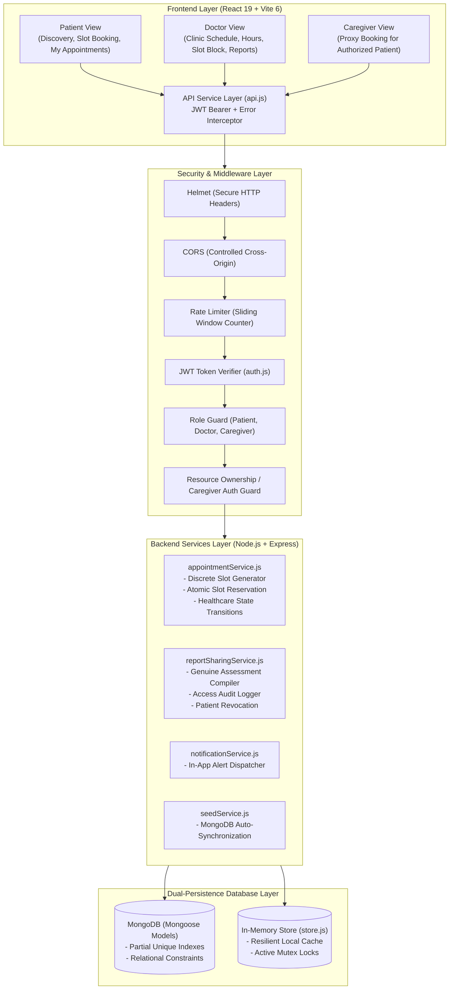
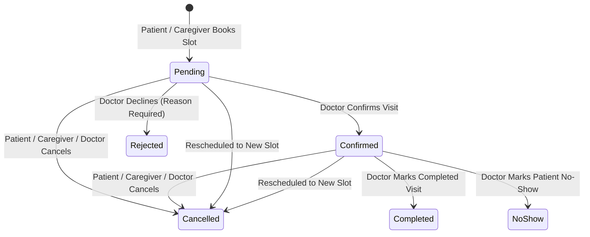

# NeuroGuard AI — Doctor Appointment Management System Architecture

## 1. System Mission & Core Constraints

The **Doctor Appointment Management System** connects NeuroGuard recovery patients with certified healthcare specialists for **physical, in-person clinical consultations**.

> [!IMPORTANT]
> **Absolute Architectural Constraint:** Every appointment in this module represents an **in-person, physical clinical visit** at a hospital or outpatient rehabilitation clinic.
> Telemedicine, virtual calls, video meeting rooms, and online consultation selectors are strictly excluded by design.

---

## 2. Architecture Overview

NeuroGuard AI uses a decoupled MERN architecture with dual-mode data persistence (MongoDB with a resilient in-memory fallback store).



---

## 3. Database Models & Schema Design

### 3.1. `Doctor` Model (`models/Doctor.js`)
Persists clinician profiles, verified qualifications, experience, physical clinic locations, and consultation fees.

- `id`: String (Unique, Indexed)
- `userId`: String (Unique, references User account)
- `name`: String (Required)
- `specialization`: Enum (`Neurology`, `Physical Medicine and Rehabilitation`, `Physiotherapy`, `Occupational Therapy`, `Speech and Language Therapy`, `Neurorehabilitation`)
- `qualifications`: [String] (e.g. MBBS, MD, Fellowship)
- `experienceYears`: Number
- `consultationFee`: Number (Standardized clinic fee snapshot)
- `bio`: String
- `clinic`: Object
  - `name`: String (Clinic/Hospital name)
  - `address`: String (Street and area)
  - `city`: String (Metro area)
  - `roomNumber`: String (OPD suite or room)
  - `phone`: String (Physical clinic contact desk)
- `rating`: Number (1 to 5)
- `isActive`: Boolean (Default: true)

### 3.2. `DoctorAvailability` Model (`models/DoctorAvailability.js`)
Configures regular clinic days, hours, slot durations, clinic breaks, and clinician blocks.

- `id`: String (Unique, Indexed)
- `doctorId`: String (Unique, Indexed)
- `workingDays`: [Number] (0: Sun to 6: Sat; default: `[1, 2, 3, 4, 5]`)
- `dayStartTime`: String (HH:mm; default: `"09:00"`)
- `dayEndTime`: String (HH:mm; default: `"17:00"`)
- `slotDurationMinutes`: Number (15, 20, 30, 45, 60; default: `30`)
- `breakStartTime`: String (HH:mm; default: `"13:00"`)
- `breakEndTime`: String (HH:mm; default: `"14:00"`)
- `unavailableDates`: [String] (YYYY-MM-DD)
- `blockedSlots`: Array of `{ id, date, startTime, endTime, reason }`

### 3.3. `Appointment` Model (`models/Appointment.js`)
Represents an in-person physical clinical visit with controlled lifecycle state transitions.

- `id`: String (Unique, Indexed)
- `patientId`: String (Indexed)
- `patientName`: String
- `doctorId`: String (Indexed)
- `doctorName`: String
- `doctorSpecialty`: String
- `clinic`: Snapshot of physical clinic name, address, city, room, and desk phone
- `date`: String (YYYY-MM-DD, Indexed)
- `startTime`: String (HH:mm)
- `endTime`: String (HH:mm)
- `status`: Enum (`pending`, `confirmed`, `rejected`, `cancelled`, `completed`, `no-show`)
- `consultationFee`: Number (Fee snapshot at booking time)
- `reason`: String (Patient-provided reason / symptoms)
- `bookedBy`: Object (`userId`, `role`: `patient` | `caregiver`, `name`)
- `cancellation`: Object (`cancelledBy`, `cancelledByRole`, `cancelledAt`, `reason`)
- `rejection`: Object (`rejectedBy`, `rejectedAt`, `reason`)
- `sharedReportId`: String (Optional reference to authorized `SharedRecoveryReport`)
- `rescheduleInfo`: Object (`rescheduledFromId`, `rescheduledAt`, `previousSlot`)

#### Atomic Reservation Index (MongoDB):
```javascript
AppointmentSchema.index(
  { doctorId: 1, date: 1, startTime: 1 },
  {
    unique: true,
    partialFilterExpression: { status: { $in: ['pending', 'confirmed'] } }
  }
);
```

### 3.4. `SharedRecoveryReport` Model (`models/SharedRecoveryReport.js`)
Handles explicit, patient-authorized clinical data sharing between a patient and an attending doctor.

- `id`: String (Unique, Indexed)
- `patientId`: String (Indexed)
- `patientName`: String
- `doctorId`: String (Indexed)
- `doctorName`: String
- `appointmentId`: String (Indexed, optional)
- `status`: Enum (`active`, `revoked`)
- `reportData`: Object (Immutable snapshot of genuine assessment metrics, baseline deltas, and session tracking quality)
- `sharedAt`: Date
- `revokedAt`: Date
- `accessAuditLog`: Array of `{ doctorId, doctorUserId, action: 'shared'|'viewed'|'revoked', accessedAt, ip, userAgent }`

### 3.5. `Notification` Model (`models/Notification.js`)
In-app alert delivery for booking confirmations, declines, cancellations, rescheduling, and report access.

- `id`: String (Unique, Indexed)
- `userId`: String (Indexed)
- `type`: Enum (`booking_created`, `booking_confirmed`, `booking_rejected`, `appointment_cancelled`, `appointment_rescheduled`, `report_shared`, `report_revoked`)
- `title`: String
- `message`: String
- `appointmentId`: String
- `read`: Boolean (Default: false)
- `createdAt`: Date

---

## 4. Slot Generation & Critical Concurrency Defense

### 4.1. Discrete Slot Calculation
For any doctor and future date $D$:
1. Check date validity (rejects past dates or malformed formats).
2. Check if $D$'s day of the week is in `workingDays`.
3. Check if $D$ is in `unavailableDates`.
4. Iterate from `dayStartTime` to `dayEndTime` in increments of `slotDurationMinutes`.
5. Exclude slots overlapping `[breakStartTime, breakEndTime]`.
6. Exclude slots overlapping doctor `blockedSlots`.
7. Query existing active bookings (`pending` or `confirmed`).
8. Return list of slot intervals with availability flag and reason (`Reserved`, `Clinic Break`, `Clinical Conference`, etc.).

### 4.2. Concurrency & Race Condition Defense
To prevent double booking when two patients click "Confirm" on the exact same doctor slot at the same millisecond:
1. **Memory Mutex:** An active booking key set `activeBookingLocks` (`${doctorId}:${date}:${startTime}`) locks the slot during processing.
2. **MongoDB Partial Unique Index:** If a concurrent request bypasses memory locks in a clustered environment, MongoDB throws `E11000 duplicate key error`.
3. **HTTP 409 Conflict:** The losing request receives an immediate, safe `409 Conflict` response with an explanatory message instructing the patient to pick another slot.
4. **Rollback Safety:** Failed database writes automatically release any held locks and prevent orphaned state.

---

## 5. Controlled Appointment State Transitions



---

## 6. NeuroGuard Recovery Report Sharing Flow

1. **Compilation:** The backend gathers real patient assessment records from `assessments` (or MongoDB), derives the true moving-window baseline (`personalBaseline`), and computes longitudinal deviations.
2. **Preview:** The patient reviews the generated report preview, which includes measured metrics (movement, symmetry, stability, speech), completed sessions, and a prominent non-diagnostic disclaimer.
3. **Authorization:** The patient selects an appointment or attending doctor, checks an explicit consent statement, and triggers sharing.
4. **Access Control:** The doctor can view the report **only if** they are the authenticated recipient and the report status is `active`.
5. **Audit Logging:** Every viewing action appends `{ doctorId, accessedAt, ip, userAgent }` to the audit log.
6. **Revocation:** The patient can revoke access at any time via `DELETE /api/reports/shares/:shareId`. Any subsequent access attempt by the doctor immediately yields `403 Forbidden`.
