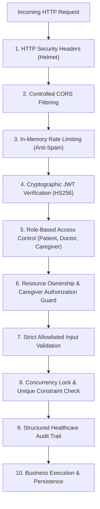

# NeuroGuard AI — Doctor Appointment Security & Threat Mitigation

## 1. Threat Modeling & Security Principles

The Doctor Appointment Management System operates under a **Defense-in-Depth** model specifically tailored for healthcare applications.



---

## 2. Identified Vulnerabilities & Implemented Mitigations

### 2.1. Insecure Direct Object References (IDOR) & Broken Access Control
- **Risk:** A patient changing an appointment ID in a URL to view or cancel another patient’s medical appointment. Or an arbitrary doctor viewing an unrelated patient’s clinical records.
- **Implemented Mitigation:**
  - `requireSelfOrDoctor` middleware and appointment ownership checks.
  - Every appointment lookup checks:
    ```javascript
    const isOwner = req.user.role === 'patient' && req.user.userId === appointment.patientId;
    const isAuthorizedCaregiver = req.user.role === 'caregiver' && isCaregiverAuthorized(req.user.userId, appointment.patientId);
    const isAssignedDoctor = req.user.role === 'doctor' && (req.user.userId === doctor.userId || req.user.userId === appointment.doctorId);
    if (!isOwner && !isAuthorizedCaregiver && !isAssignedDoctor) {
      return res.status(403).json({ message: "Forbidden: You do not have access to this appointment." });
    }
    ```
  - Tested and verified in `backend/test/appointmentSecurity.test.js` (Tests S4, S5, S6, S10).

### 2.2. Caregiver Privilege Escalation
- **Risk:** A user with role `caregiver` attempting to book or view appointments for arbitrary patient IDs without explicit authorization.
- **Implemented Mitigation:**
  - `isCaregiverAuthorized(caregiverUserId, patientId)` validates that the patient's record explicitly lists the caregiver in `authorizedCaregivers`, or the caregiver record contains the patient in `caregiverPatients`.
  - Knowing a patient ID alone is insufficient; requests without a registered relationship return `403 Forbidden`.
  - Tested and verified in Test S5.

### 2.3. Double Booking & Race Condition Exploitation
- **Risk:** Malicious scripts or simultaneous users submitting bookings for the exact same slot at the exact same millisecond.
- **Implemented Mitigation:**
  - **Memory Mutex:** `activeBookingLocks` set tracks in-flight bookings per `${doctorId}:${date}:${startTime}`.
  - **MongoDB Partial Unique Index:**
    `{ doctorId: 1, date: 1, startTime: 1 }` with `{ status: { $in: ['pending', 'confirmed'] } }` enforces uniqueness at the database engine level.
  - Returns `409 Conflict` on race conditions, preventing double-allocation.
  - Tested and verified in Test 20 of `appointments.test.js`.

### 2.4. Recovery Report Unauthorized Exposure & Revocation Bypass
- **Risk:** A doctor viewing a patient's historical rehabilitation data after the patient has revoked consent, or viewing a report intended for another physician.
- **Implemented Mitigation:**
  - The `SharedRecoveryReport` model enforces that only the specified `doctorId` can read the document.
  - Every read checks `status === 'active'`. If the patient called revoke (`status = 'revoked'`), any subsequent doctor request receives `403 Forbidden: Access to this recovery report has been revoked by the patient.`
  - An append-only `accessAuditLog` records every viewing with `{ doctorId, accessedAt, ip, userAgent }`.
  - Tested and verified in Test S10.

### 2.5. NoSQL & MongoDB Operator Injection
- **Risk:** Attacking query objects using operators like `{ "$gt": "" }` in request bodies.
- **Implemented Mitigation:**
  - All route parameters and request body strings are explicitly coerced and validated (e.g. `String(date).trim()`, regex matching `^\d{4}-\d{2}-\d{2}$`, `HH:mm`).
  - No raw, unsanitized `req.body` objects are passed directly to Mongoose queries or update operators.

### 2.6. Mass Assignment & Prototype Pollution
- **Risk:** An attacker injecting privileged fields (such as `rating`, `isActive`, `status`, `doctorId`) in profile or booking updates.
- **Implemented Mitigation:**
  - Explicit allowlisting of update keys in `doctorRoutes.js` and `appointmentRoutes.js`.
  - Only permitted fields (`consultationFee`, `bio`, `clinic`) are extracted; arbitrary properties are ignored.

### 2.7. API Abuse & Booking Spam
- **Risk:** Automated scripts spamming booking slots to lock up a clinician's calendar.
- **Implemented Mitigation:**
  - In-memory sliding-window rate limiter middleware (`middleware/rateLimiter.js`) applied to `POST /api/appointments` (max 15 requests/minute per client).
  - Returns `429 Too Many Requests` with `Retry-After` headers.

### 2.8. HTTP Security Headers
- **Risk:** Clickjacking, MIME-sniffing, and cross-site scripting vulnerabilities.
- **Implemented Mitigation:**
  - Integrated `helmet` with `crossOriginResourcePolicy: { policy: 'cross-origin' }` to protect Express headers without interfering with local MediaPipe camera WebAssembly models or Vite frontend modules.

---

## 3. Healthcare Data Security & Compliance Considerations

- **Least Privilege Access:** Patient recovery data is scoped strictly to the patient, explicitly authorized caregivers, and specifically authorized clinicians.
- **Informed Patient Consent:** Report sharing requires an active affirmative checkbox consent before access credentials are generated.
- **Auditability:** Complete audit trails exist for report generation, sharing, viewing, and revocation.
- **Regulatory Frameworks:** While these technical controls implement foundational security best practices, formal legal compliance with HIPAA (US) or the Digital Personal Data Protection Act (DPDP Act, India) requires certified organizational policies, clinical review boards, and encrypted data-at-rest storage infrastructure.
