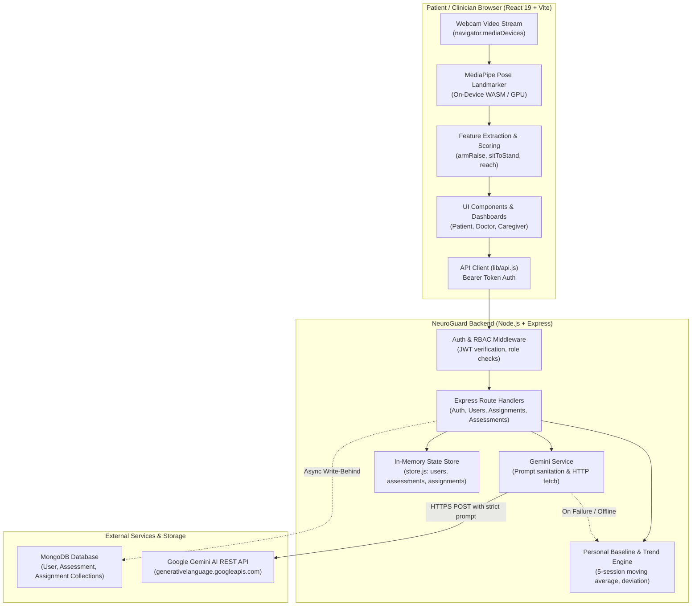

# 01 — Project Overview & System Context

## 1. Executive Summary & Clinical Mission

**NeuroGuard AI** is a specialized, privacy-first software platform designed to assist stroke survivors and their rehabilitation clinicians in monitoring functional motor recovery at home. 

Following a stroke, motor and coordination rehabilitation requires consistent, high-frequency physical exercise and longitudinal functional evaluation. However, clinical barriers often impede effective long-term recovery:
- **Infrequent Clinical Appointments:** Patients typically see a physical therapist or neurologist only once every few weeks or months, creating long observational blind spots.
- **Subjective Self-Reporting:** Patients frequently struggle to accurately report whether their range of motion, symmetry, or stability is improving, plateauing, or deteriorating.
- **Privacy and Bandwidth Constraints:** Standard remote monitoring often relies on uploading raw video streams to cloud servers, introducing patient privacy risks, high bandwidth requirements, and substantial storage costs.
- **Lack of Baseline Grounding:** Many health metrics compare an individual against generic population averages rather than measuring progress against the patient's own post-stroke personal baseline.

NeuroGuard AI addresses these challenges by executing **real-time pose estimation and movement feature extraction directly inside the patient's web browser** using Google MediaPipe Tasks Vision. Only structured numerical metrics (e.g., joint angles, range of motion, movement symmetry, rep counts) are transmitted to the backend. The platform provides personal baseline comparisons, longitudinal trend tracking, clinical protocol assignments, doctor oversight, and plain-language AI-assisted summaries powered by Google Gemini with a deterministic local fallback engine.

> [!IMPORTANT]
> **Non-Diagnostic Scope:** NeuroGuard AI is explicitly designed as a functional monitoring and rehabilitation assistance prototype. It **does not diagnose medical conditions, replace qualified clinicians, prescribe pharmacological treatments, or detect acute medical emergencies**. All metrics and AI explanations are framed as assistive observations relative to a personal baseline.

---

## 2. Intended User Roles & Needs

| Role | User Persona | Core Problem Addressed | Primary System Capabilities |
|---|---|---|---|
| **Patient** | Stroke survivor recovering at home (e.g., *Raj Kumar*, age 58) | Uncertainty regarding recovery progress, difficulty remembering exercise instructions, anxiety about whether changes are normal. | Complete assigned or self-directed movement checks via camera; view personal baseline progress; receive plain-language summaries; view doctor notes. |
| **Doctor / Clinician** | Neurologist or Physical Therapist (e.g., *Dr. Priya Nair*, Neurorehabilitation) | Lack of objective data between visits; inability to enforce customized exercise protocols remotely; time-consuming review processes. | View assigned patient roster prioritized by clinical need (Review Recommended → Monitor → Stable); assign specific exercise protocols with targets and custom instructions; review completed sessions and sign off with feedback. |
| **Caregiver** | Family member or dedicated caregiver (e.g., *Anita Sharma*) | Needs high-level visibility into patient recovery trends without clinical complexity; requires alerts when persistent declines occur. | High-level status overview of patient recovery (Stable / Monitor / Review); trend visualization; persistent decline alert monitoring. |

---

## 3. High-Level Technology Stack

The repository is organized as a decoupled two-tier architecture:

```text
[ Browser Client ]  <--- HTTPS / WSS / REST --->  [ Express Backend ]  <--- Driver --->  [ MongoDB Atlas ]
   React 19 + Vite                                    Node.js + Express 4                    (Optional Persistent Store)
   MediaPipe Vision (Local)                           JWT + bcryptjs
   Recharts 2.15                                      Google Gemini API
```

### Frontend Architecture
- **Framework:** React 19.0.0 (SPA, ESM)
- **Bundler & Dev Server:** Vite 6.0.5 (`@vitejs/plugin-react` 4.3.4)
- **Computer Vision:** `@mediapipe/tasks-vision` 0.10.22
- **Model Assets:** Local on-device execution using `pose_landmarker_lite.task` (5.78 MB) and WebAssembly (`/public/mediapipe/wasm/`)
- **Visualizations:** Recharts 2.15.0 (SVG-based reactive line and trend charts)
- **Icons & UI:** `lucide-react` 0.468.0, custom modular CSS design system (`app.css`)
- **State Management:** React hooks (`useState`, `useEffect`, `useMemo`, `useRef`), `sessionStorage` token caching

### Backend Architecture
- **Runtime:** Node.js (tested on v22.21.1)
- **Web Framework:** Express 4.21.2 (CommonJS)
- **Authentication & Security:** JSON Web Tokens (`jsonwebtoken` 9.0.3), Password Hashing (`bcryptjs` 3.0.3), CORS (`cors` 2.8.5)
- **Database & ODM:** MongoDB (`mongodb` 6.12.0) via Mongoose 8.9.5 with resilient in-memory fallback
- **AI Integration:** Google Gemini REST API (`gemini-3.5-flash-lite`) via native `fetch` with AbortController timeout handling
- **Testing:** Node.js native test runner (`node:test`, `node:assert/strict`)

---

## 4. High-Level Architecture Diagram



---

## 5. Main User Journeys

### User Journey 1: Patient Completing a Clinician-Assigned Assessment
1. **Login:** Patient signs in with credentials (`raj@neuroguard.demo` / `patient123`). Receives JWT and user profile.
2. **Dashboard Review:** Patient arrives at `PatientDashboard`, viewing current functional score (79/100), baseline trend (+9.7%), and active prescribed protocols.
3. **Assignment Initiation:** Patient sees an active protocol assigned by *Dr. Priya Nair* ("Arm Raise · 5 reps · Keep shoulders relaxed"). Patient clicks "Start Assigned Protocol".
4. **Camera Execution:** Browser opens webcam, downloads local MediaPipe model and WASM binaries, renders skeleton overlay on HTML5 canvas, and provides live angle, symmetry, and elevation feedback.
5. **Quality Verification:** Upon completion, the client verifies duration and frame tracking count before sending payload to `POST /api/assessments`.
6. **Persistence & Linking:** Backend validates tracking quality, links session to assignment ID, marks assignment status as `completed`, records session metrics, and attempts write-behind to MongoDB.
7. **AI Analysis:** Dashboard requests explanation via `POST /api/explanation`. Gemini translates metric deviations into 2-3 empathetic sentences.

### User Journey 2: Doctor Protocol Assignment and Review
1. **Login:** Clinician signs in (`priya@neuroguard.demo` / `doctor123`).
2. **Roster Prioritization:** Clinician lands on `DoctorPage`, viewing patients sorted by urgency (`Review recommended` first, then `Monitor`, then `Stable`).
3. **Patient Deep-Dive:** Clinician selects a patient (`Raj Kumar`). Client loads full longitudinal trends, alerts, and assignment history.
4. **Protocol Prescription:** Clinician clicks "Assign Assessment", selects exercise type (`arm_raise`), sets target repetitions (5), sets due date, types tailored instructions, and submits via `POST /api/assignments`.
5. **Session Review:** Once the patient completes the session, the doctor sees the completed session score and tracking quality warnings. The clinician enters clinical feedback notes ("Great shoulder elevation today, continue holding 1s at apex") and approves the session via `PATCH /api/assignments/:id/status` (status: `reviewed`).
6. **Patient Visibility:** The doctor's feedback immediately displays in the patient's dashboard under "Clinician Care Plan".

---

## 6. What the Application Does vs. What It Does Not Do

### What NeuroGuard AI Does
- ✅ **Tracks Upper and Lower Body Motion Locally:** Extracts 33 3D pose landmarks at up to 30 frames/sec without transmitting pixels across the network.
- ✅ **Calculates Deterministic Kinematic Features:** Derives arm elevation, bilateral symmetry, elbow extension, knee flexion/extension, and seated reaching distance.
- ✅ **Constructs Personal Baselines:** Calculates rolling 5-session averages for functional scores and individual metrics, ignoring population biases.
- ✅ **Flags Statistical Deviations:** Identifies variations (≤5% Normal, ≤10% Monitor, ≤15% Significant, >15% or 3 consecutive drops = Review Recommended).
- ✅ **Enforces Doctor-Patient Boundaries:** Restricts patient access strictly to own records; doctors access only assigned patients.
- ✅ **Sanitizes AI Inputs:** Strips unmeasured metrics so Gemini never discusses domains that were not assessed.
- ✅ **Operates with In-Memory Resiliency:** Functions smoothly during demonstrations even when MongoDB is offline or unavailable.

### What NeuroGuard AI Does NOT Do
- ❌ **Does NOT Provide Medical Diagnoses:** Does not diagnose stroke subtypes, hemiplegia severity scales (e.g., Fugl-Meyer scores), or neurological pathologies.
- ❌ **Does NOT Predict Medical Emergencies:** Does not detect acute strokes, falls, or cardiovascular distress.
- ❌ **Does NOT Retain Video or Audio:** Camera frames are strictly processed in volatile browser memory and discarded immediately after landmark extraction.
- ❌ **Does NOT Allow AI to Invent Metrics:** Gemini is never prompted to calculate scores or generate treatment prescriptions.
- ❌ **Does NOT Read History from MongoDB (Current Prototype State):** While MongoDB persistence is implemented for writes, read operations are fulfilled from in-memory arrays.
