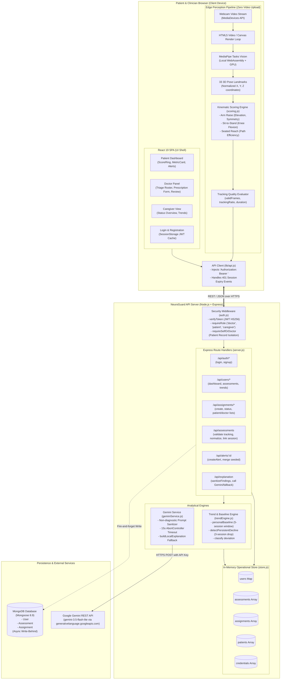
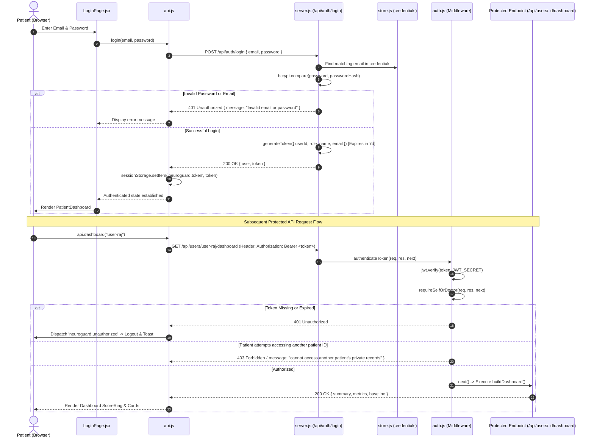
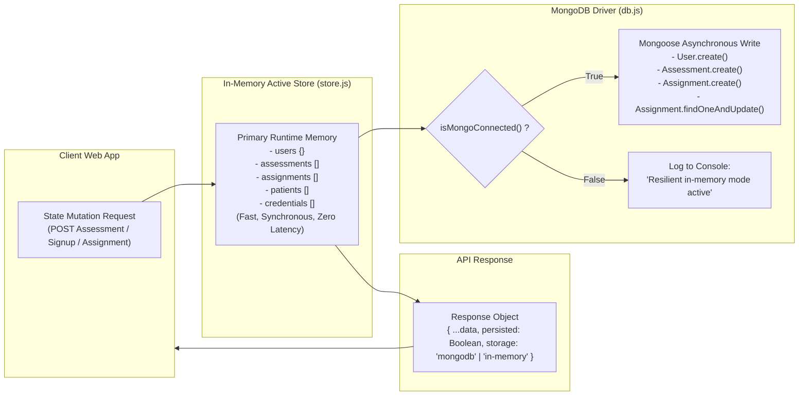

# 04 — System Architecture & Data Flows

This document details the architectural topology, data pipelines, security boundaries, and end-to-end execution workflows of NeuroGuard AI.

---

## 1. Overall System Architecture

The NeuroGuard AI architecture is structured around two distinct operational domains:
1. **Client-Side Edge Perception:** Real-time video processing, anatomical pose landmark extraction, kinematic joint angle calculation, and repetition counting execute entirely on the patient's device inside the browser.
2. **Server-Side Clinical Intelligence & Persistence:** Moving baseline mathematics, longitudinal deviation detection, access control boundaries, AI explanation sanitation, and dual-mode data persistence execute in the Node.js/Express environment.

---

## 2. Authentication & Authorization Flow

---

## 3. End-to-End Assessment Protocol Lifecycle

This sequence diagrams the complete doctor-prescription $\rightarrow$ patient-execution $\rightarrow$ doctor-review loop:

```mermaid
sequenceDiagram
    autonumber
    actor Doctor as Doctor (Dr. Priya)
    actor Patient as Patient (Raj Kumar)
    participant DocUI as DoctorPage.jsx
    participant PatUI as PatientDashboard.jsx
    participant CamUI as CameraAssessment.jsx
    participant Server as Express Server
    participant Mongo as MongoDB (Mongoose)

    Doctor->>DocUI: Select Patient -> Fill "Assign Assessment" Form
    DocUI->>Server: POST /api/assignments (Auth: Doctor Token)<br/>{ patientId, exerciseType: "arm_raise", targetReps: 5, instructions: "5 slow reps", dueDate }
    Server->>Server: Validate authorization & instructions
    Server->>Server: Push assignment { id: asgn-123, status: "assigned" }
    Server-.->Mongo: Assignment.create(assignment)
    Server-->>DocUI: 201 Created { assignment }

    Note over Patient, PatUI: Patient Sees Prescribed Protocol
    Patient->>PatUI: Open Dashboard
    PatUI->>Server: GET /api/patients/user-raj/assignments
    Server-->>PatUI: 200 OK [ { id: asgn-123, status: "assigned", instructions: "..." } ]
    PatUI->>Patient: Render "Prescribed Functional Protocols" banner

    Patient->>PatUI: Click "Start Assigned Protocol"
    PatUI->>CamUI: Mount CameraAssessment (assignmentId: "asgn-123")
    CamUI->>CamUI: getUserMedia({ video: true })
    CamUI->>CamUI: Load MediaPipe PoseLandmarker (Local WASM)
    Note over CamUI: Patient performs 5 bilateral arm raises
    CamUI->>CamUI: Track frame elevations, symmetry & reps
    Patient->>CamUI: Click "Finish"
    CamUI->>CamUI: buildArmRaiseSession(frames)
    CamUI->>PatUI: onComplete(sessionResult)

    PatUI->>Server: POST /api/assessments (Auth: Patient Token)<br/>{ userId, exerciseType: "arm_raise", duration: 82, score: 79, metrics, assignmentId: "asgn-123", trackingQuality }
    Server->>Server: Validate trackingQuality (isValid !== false && validFrames >= 5)
    Server->>Server: Normalize metrics (delete unmeasured balance/speech)
    Server->>Server: Update assignment asgn-123 status = "completed", completedSessionId = assessment-456
    Server-.->Mongo: Assessment.create() & Assignment.findOneAndUpdate()
    Server-->>PatUI: 201 Created { id: assessment-456, storage: "mongodb" | "in-memory" }

    Note over Doctor, DocUI: Doctor Reviews Completed Session
    Doctor->>DocUI: Select Raj Kumar -> Sees Protocol Status "Completed"
    DocUI->>Doctor: Displays completed session score (79/100) & tracking notes
    Doctor->>DocUI: Enter Feedback: "Symmetry looking much better" -> Click "Approve & Sign Off"
    DocUI->>Server: PATCH /api/assignments/asgn-123/status<br/>{ status: "reviewed", doctorNotes: "Symmetry looking much better" }
    Server->>Server: Verify doctor ownership -> update status = "reviewed"
    Server-.->Mongo: Assignment.findOneAndUpdate()
    Server-->>DocUI: 200 OK { assignment }

    Patient->>PatUI: Refresh Dashboard
    PatUI->>Patient: Displays "Reviewed by Clinician" with Doctor's Note
```

---

## 4. Personal Baseline & AI Explanation Pipeline

The following diagram traces how raw metrics are normalized, compared against personal baseline history, filtered server-side, and translated into plain-language summaries by Google Gemini or the deterministic fallback engine:

```mermaid
flowchart TD
    subgraph Capture["1. Session Completion"]
        Raw["Raw Exercise Metrics\n(ROM: 82, Symmetry: 76, reps: 5)"]
    end

    subgraph Normalization["2. Server Normalization (/api/assessments)"]
        Raw --> NormCheck{"Exercise Type?"}
        NormCheck -->|arm_raise| SetArm["movement = ROM\ncoordination = symmetry\nDELETE balance & speech"]
        NormCheck -->|sit_to_stand| SetSit["movement = quality\nbalance = stability\nDELETE speech & coordination"]
        NormCheck -->|seated_reach| SetReach["movement = quality\ncoordination = pathEfficiency\nDELETE balance & speech"]
    end

    subgraph TrendAnalysis["3. Baseline Engine (trendEngine.js)"]
        SetArm & SetSit & SetReach --> History[("Patient Assessment History\n(Ordered chronologically)")]
        History --> PriorWindow["Extract Prior Sessions (excluding latest)\nWindow = min(prior.length, 5)"]
        PriorWindow --> BaseCalc["personalBaseline = mean(prior.metrics)\nDeviation = (current - baseline) / baseline"]
        BaseCalc --> Classify["Classification:\n<=5% Normal | <=10% Monitor\n<=15% Significant | >15% Review\n3-session consecutive drop = Persistent Decline"]
        Classify --> DashOutput["buildDashboard() Response\n{ summary: { trend, change },\n  metrics: { Movement: { value, change, measured: true }, Balance: null },\n  baseline: { window: 5 } }"]
    end

    subgraph Sanitization["4. Server-Side Metric Whitelisting (sanitizeFindings)"]
        DashOutput --> ClientFilter["Client builds payload:\nOnly metrics with measured:true and non-null change"]
        ClientFilter --> APIExp["POST /api/explanation"]
        APIExp --> ServerSanitize["sanitizeFindings()\n- Whitelist trend in [stable, improving, declining, persistent_decline]\n- Strip unmeasured domains\n- Truncate details to 500 chars"]
    end

    subgraph Generation["5. Explanation Generation (geminiService.js)"]
        ServerSanitize --> KeyCheck{"process.env.GEMINI_API_KEY\nConfigured?"}
        
        KeyCheck -->|No| LocalEngine["buildLocalExplanation(findings)\nDeterministic Rule-Based Text"]
        LocalEngine --> ReturnLocal["Return { source: 'local', text }"]

        KeyCheck -->|Yes| PromptBuilder["Construct Strict System Prompt:\n- Prohibit medical diagnoses\n- Prohibit medication advice\n- Prohibit mentioning absent metrics\n- Note baseline session count"]
        PromptBuilder --> FetchCall["fetch('https://generativelanguage.googleapis.com/v1beta/models/gemini-3.5-flash-lite:generateContent')\nTimeout: 15000ms AbortController"]
        
        FetchCall --> APIResult{"API Call Result?"}
        APIResult -->|200 OK + Candidates| GeminiSuccess["Return { source: 'gemini', text: candidateText }"]
        APIResult -->|401 / 404 / 429 / Timeout / Network Error| Fallback["Log formatDiagnosticMessage()\nbuildLocalExplanation(findings)"]
        Fallback --> ReturnFallback["Return { source: 'local-fallback', text }"]
    end

    subgraph Rendering["6. UI Rendering"]
        GeminiSuccess & ReturnLocal & ReturnFallback --> BadgeSelect["UI Badging:\n- source === 'gemini' -> 'Gemini AI'\n- source === 'local-fallback' -> 'Local Fallback'\n- source === 'local' -> 'Personal Baseline Engine'"]
        BadgeSelect --> RenderCard["Render in PatientDashboard / DoctorPage with ShieldCheck Disclaimer"]
    end
```

---

## 5. Storage Architecture & Offline Resiliency

The platform maintains two parallel storage strategies:

### Architectural Key Takeaway on Persistence
- **Query Path:** All GET endpoints (`/api/users/:id/dashboard`, `/api/users/:id/trends`, `/api/patients/:id/assignments`, etc.) read exclusively from the synchronous in-memory store in `store.js`.
- **Write Path:** All POST/PATCH endpoints mutate in-memory state first, then trigger non-blocking Mongoose writes if `isMongoConnected()` is true.
- **Failover Behavior:** If MongoDB is offline, unconfigured, or drops connection, zero runtime exceptions occur; the application continues operating seamlessly in in-memory session mode.
