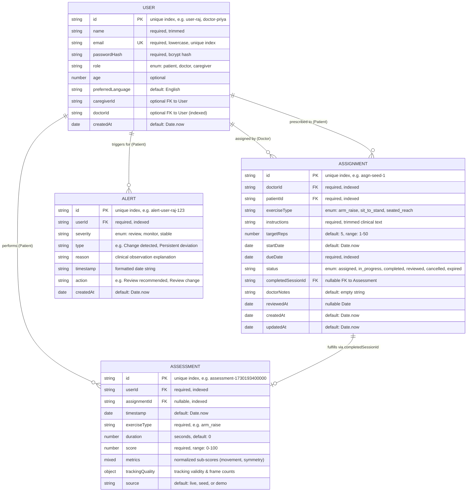

# 07 — Database & Data Models

This report provides an in-depth audit of all data schemas, models, indexes, relationships, and persistence mechanisms in NeuroGuard AI.

---

## 1. Entity-Relationship Diagram (ERD)

The following Mermaid ERD visualizes the logical data model across users, clinical assignments, assessment sessions, and longitudinal alerts:

---

## 2. Mongoose Model Specifications

### Model 1: `User` (`backend/src/models/User.js`)
- **Collection Name:** `users` (Mongoose pluralization default).
- **Primary Key:** `id` (String, unique, indexed).
- **Fields:**
  - `id`: `{ type: String, required: true, unique: true, index: true }`
  - `name`: `{ type: String, required: true, trim: true }`
  - `email`: `{ type: String, required: true, unique: true, lowercase: true, trim: true }`
  - `passwordHash`: `{ type: String, required: true }`
  - `role`: `{ type: String, enum: ['patient', 'doctor', 'caregiver'], default: 'patient' }`
  - `age`: `{ type: Number }`
  - `preferredLanguage`: `{ type: String, default: 'English' }`
  - `caregiverId`: `{ type: String }` (Points to caregiver's `User.id`)
  - `doctorId`: `{ type: String, index: true, default: null }` (Points to doctor's `User.id`)
  - `createdAt`: `{ type: Date, default: Date.now }`
- **Active Operations:**
  - Written in `server.js` line 122 during `POST /api/auth/signup` via `User.create()`.
  - **Read in runtime:** NEVER read from MongoDB. The application checks in-memory `users` dictionary in `store.js`.

---

### Model 2: `Assignment` (`backend/src/models/Assignment.js`)
- **Collection Name:** `assignments`.
- **Primary Key:** `id` (String, unique, indexed).
- **Fields:**
  - `id`: `{ type: String, required: true, unique: true, index: true }`
  - `doctorId`: `{ type: String, required: true, index: true }`
  - `patientId`: `{ type: String, required: true, index: true }`
  - `exerciseType`: `{ type: String, required: true, enum: ['arm_raise', 'sit_to_stand', 'seated_reach'], default: 'arm_raise' }`
  - `instructions`: `{ type: String, required: true, trim: true }`
  - `targetReps`: `{ type: Number, default: 5, min: 1, max: 50 }`
  - `startDate`: `{ type: Date, default: Date.now }`
  - `dueDate`: `{ type: Date, required: true }`
  - `status`: `{ type: String, enum: ['assigned', 'in_progress', 'completed', 'reviewed', 'cancelled', 'expired'], default: 'assigned', index: true }`
  - `completedSessionId`: `{ type: String, default: null }`
  - `doctorNotes`: `{ type: String, default: '' }`
  - `reviewedAt`: `{ type: Date, default: null }`
  - `createdAt`: `{ type: Date, default: Date.now }`
  - `updatedAt`: `{ type: Date, default: Date.now }`
- **Active Operations:**
  - Created in `POST /api/assignments` via `Assignment.create()` (line 277).
  - Updated in `PATCH /api/assignments/:id/status` via `Assignment.findOneAndUpdate()` (line 406).
  - Updated upon assessment completion in `POST /api/assessments` via `Assignment.findOneAndUpdate()` (line 545).
  - **Read in runtime:** NEVER read from MongoDB. Queried from `assignments` array in `store.js`.

---

### Model 3: `Assessment` (`backend/src/models/Assessment.js`)
- **Collection Name:** `assessments`.
- **Primary Key:** `id` (String, unique, indexed).
- **Fields:**
  - `id`: `{ type: String, required: true, unique: true, index: true }`
  - `userId`: `{ type: String, required: true, index: true }`
  - `assignmentId`: `{ type: String, index: true, default: null }`
  - `timestamp`: `{ type: Date, default: Date.now }`
  - `exerciseType`: `{ type: String, required: true }`
  - `duration`: `{ type: Number, default: 0 }` (seconds)
  - `score`: `{ type: Number, required: true, min: 0, max: 100 }`
  - `metrics`: `{ type: mongoose.Schema.Types.Mixed, default: {} }`
  - `trackingQuality`:
    - `validFrames`: `{ type: Number, default: 0 }`
    - `totalFrames`: `{ type: Number, default: 0 }`
    - `trackingRatio`: `{ type: Number, default: 1 }`
    - `qualityWarning`: `{ type: String, default: null }`
    - `isValid`: `{ type: Boolean, default: true }`
  - `source`: `{ type: String, default: 'live' }` (`live`, `seed`, `demo`)
- **Active Operations:**
  - Created in `POST /api/assessments` via `Assessment.create()` (line 554).
  - **Read in runtime:** NEVER read from MongoDB. Queried from `assessments` array in `store.js`.

---

### Model 4: `Alert` (`backend/src/models/Alert.js`)
- **Collection Name:** `alerts`.
- **Primary Key:** `id` (String, unique, indexed).
- **Fields:**
  - `id`: `{ type: String, required: true, unique: true, index: true }`
  - `userId`: `{ type: String, required: true, index: true }`
  - `severity`: `{ type: String, enum: ['review', 'monitor', 'stable'], default: 'monitor' }`
  - `type`: `{ type: String, required: true }`
  - `reason`: `{ type: String, required: true }`
  - `timestamp`: `{ type: String, required: true }`
  - `action`: `{ type: String, required: true }`
  - `createdAt`: `{ type: Date, default: Date.now }`
- **Active Operations:**
  - **Dormant / Unused Model.** Imported in `server.js` line 12, but never written to or read from MongoDB. The application stores alerts in a JavaScript `Map` in `store.js` and creates them on-the-fly using `trendEngine.createAlert()`.

---

## 3. Dual Storage Architecture: Memory vs. MongoDB

### Comparison Matrix

| Property | In-Memory Mode (`store.js`) | MongoDB Mode (`db.js` + Mongoose) |
|---|---|---|
| **Primary Query Engine** | **YES** (100% of GET endpoints read from here) | **NO** (0% of query endpoints read from here) |
| **Write Target** | **YES** (Immediate synchronous mutations) | **YES** (Asynchronous, non-blocking fire-and-forget) |
| **Persistence Across Restart** | **NO** (Resets to initial seed data on reboot) | **YES** (Stored in database collections) |
| **Multi-Process Concurrency** | Not supported (Isolated per Node instance) | Supported at DB level, but memory states diverge |
| **Connection Prerequisite** | Zero prerequisites | Requires valid `MONGODB_URI` connection string |
| **Startup Behavior** | Instantaneous | Attempts connection with 4000ms timeout |
| **Offline Resilience** | 100% operational | Continues operating in in-memory mode if DB drops |

### Architectural Implication & Data-Loss Risk
Because the application does not implement a database hydration step on startup:
1. If a developer runs the server with MongoDB, registers new patients, and saves 10 assessment sessions, the records are written to MongoDB.
2. If the Node.js process is stopped (`Ctrl+C`) and restarted, `store.js` re-initializes from its static seed file.
3. The newly registered patients and sessions will **not be visible on the frontend dashboard**, even though the data exists in MongoDB!
4. **Required Future Enhancement:** Implement a startup hydration function (e.g., `hydrateFromMongo()`) that loads persisted Users, Assessments, and Assignments from MongoDB into memory on startup.
