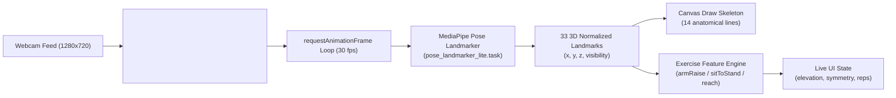

# 08 — Computer Vision & Assessment Algorithms

This document provides a technical audit of the computer vision pipeline, anatomical feature extraction mathematics, repetition counting state machines, and scoring formulations implemented in NeuroGuard AI.

---

## 1. Computer Vision Pipeline Architecture

NeuroGuard AI runs its pose perception engine entirely inside the client browser. No video frames, image snapshots, or pixel arrays are ever transmitted over the network or saved to disk.



### MediaPipe Configuration Details
- **Library:** `@mediapipe/tasks-vision` version `0.10.22`.
- **Model Variant:** `pose_landmarker_lite.task` (Float16 Lite variant, binary size: 5,777,746 bytes).
- **Execution Assets:** Served locally from `/public/models/pose_landmarker_lite.task` and WebAssembly files in `/public/mediapipe/wasm/`. No third-party CDN dependencies.
- **Hardware Acceleration:** Evaluates GPU delegate via WebGL first. If GPU initialization throws, falls back cleanly to CPU execution (`pose.js` lines 29-46).
- **Inference Thresholds:**
  - `minPoseDetectionConfidence`: `0.55`
  - `minPosePresenceConfidence`: `0.55`
  - `minTrackingConfidence`: `0.55`
  - `runningMode`: `'VIDEO'`
  - `numPoses`: `1`

---

## 2. Landmark Kinematics & Coordinate System

MediaPipe outputs 33 landmarks normalized to $[0.0, 1.0]$:
- $X$: Horizontal position ($0.0 = \text{left edge}, 1.0 = \text{right edge}$).
- $Y$: Vertical position ($0.0 = \text{top edge}, 1.0 = \text{bottom edge}$).
- $Z$: Depth relative to the mid-hip landmark (smaller values are closer to the camera).
- `visibility`: Likelihood that the landmark is visible within the frame ($[0.0, 1.0]$).

### Core Helper Functions (`frontend/src/lib/pose.js`)
1. **Visibility Filter:**
   ```javascript
   export function visiblePoint(point, threshold = 0.5) {
     return Boolean(point && (point.visibility ?? 1) >= threshold);
   }
   ```
2. **Joint Angle Calculation:**
   Calculates the interior 2D angle between three joints $A$, $B$ (vertex), and $C$:
   $$\theta = \arccos\left(\frac{\vec{BA} \cdot \vec{BC}}{\|\vec{BA}\| \|\vec{BC}\|}\right) \times \frac{180}{\pi}$$
   ```javascript
   export function angle(a, b, c) {
     const ab = { x: a.x - b.x, y: a.y - b.y };
     const cb = { x: c.x - b.x, y: c.y - b.y };
     const dot = ab.x * cb.x + ab.y * cb.y;
     const mag = Math.hypot(ab.x, ab.y) * Math.hypot(cb.x, cb.y);
     if (!mag) return 0;
     const cosine = Math.min(1, Math.max(-1, dot / mag));
     return Math.acos(cosine) * (180 / Math.PI);
   }
   ```

---

## 3. Exercise-Specific Feature Extraction & Formulations

### Exercise A: Arm Raise (`arm_raise`)
- **Clinical Target:** Evaluating hemiplegic shoulder abduction/flexion range, bilateral symmetry, and elbow extension.
- **Landmarks Monitored:** Shoulders (11, 12), Elbows (13, 14), Wrists (15, 16).
- **Per-Frame Metrics:**
  - **Elevation:** Measures vertical delta between shoulder and wrist. In inverted $Y$ screen space, a wrist above the shoulder yields a positive $(Y_{\text{shoulder}} - Y_{\text{wrist}})$:
    $$\text{Elevation}_{\text{side}} = \text{clamp}((Y_{\text{shoulder}} - Y_{\text{wrist}}) \times 120 + 50, 0, 100)$$
  - **Bilateral Symmetry:** Compares left vs right elevation:
    $$\text{Symmetry} = \text{clamp}(100 - |\text{Elevation}_{\text{left}} - \text{Elevation}_{\text{right}}| \times 1.2, 0, 100)$$
  - **Elbow Extension (Movement Quality):** Evaluates how close elbows are to straight ($180^\circ$):
    $$\text{Extension} = \text{clamp}\left(100 - \left|180 - \frac{\theta_{\text{leftElbow}} + \theta_{\text{rightElbow}}}{2}\right| \times 1.15, 0, 100\right)$$
- **Session Overall Score:**
  $$\text{Score} = 0.38 \times \text{rangeScore} + 0.27 \times \text{symmetry} + 0.20 \times \text{movementQuality} + 0.15 \times \text{repScore}$$
  where $\text{rangeScore} = \text{clamp}\left(\frac{\text{ROM}}{65} \times 100, 0, 100\right)$ and $\text{repScore} = \text{clamp}\left(\frac{\text{reps}}{5} \times 100, 0, 100\right)$.

---

### Exercise B: Sit-to-Stand (`sit_to_stand`)
- **Clinical Target:** Lower extremity functional strength, sit-to-stand transition stability, and knee joint flexion/extension.
- **Landmarks Monitored:** Hips (23, 24), Knees (25, 26), Ankles (27, 28).
- **Per-Frame Metrics:**
  - Knee Angle: $\theta_{\text{knee}} = \frac{\text{angle}(Hip_L, Knee_L, Ankle_L) + \text{angle}(Hip_R, Knee_R, Ankle_R)}{2}$
  - Trunk Height: $1 - \text{midpoint}(Hip_L, Hip_R).y$
- **Repetition State Machine:**
  - Starts in `standing`. When $\theta_{\text{knee}} < 105^\circ \rightarrow$ transitions to `sit`.
  - When in `sit` and $\theta_{\text{knee}} > 155^\circ$ with `cooldown === 0` $\rightarrow$ increments `reps += 1`, transitions to `standing`, sets `cooldown = 20` frames.
- **Session Overall Score:**
  $$\text{Score} = 0.45 \times \text{repScore} + 0.35 \times \text{rangeScore} + 0.20 \times \text{stability}$$
  where $\text{stability} = \text{clamp}(100 - (\text{KneeRange} - 80) \times 0.35, 0, 100)$.

---

### Exercise C: Seated Reach (`seated_reach`)
- **Clinical Target:** Forward functional reaching distance and trunk control.
- **Landmarks Monitored:** Shoulders (11, 12), Wrists (15, 16).
- **Per-Frame Metrics:**
  - Reaching Distance: Euclidean distance between shoulder midpoint and wrist midpoint.
    $$\text{Reach} = \text{clamp}(\|\text{midpoint}(Wrist) - \text{midpoint}(Shoulder)\| \times 180, 0, 100)$$
- **Repetition State Machine:**
  - Starts in `start`. When $\text{Reach} > 42 \rightarrow$ transitions to `reach`.
  - When in `reach` and $\text{Reach} < 25 \rightarrow$ increments `reps += 1`, resets to `start`.
- **Session Overall Score:**
  $$\text{Score} = 0.40 \times \text{movementQuality} + 0.35 \times \text{pathEfficiency} + 0.25 \times \text{repScore}$$
  where $\text{pathEfficiency} = \text{clamp}(100 - |58 - \overline{\text{Reach}}| \times 0.8, 0, 100)$.

---

## 4. Key Algorithmic Quirks & Limitations Discovered

### 1. The Post-Session Arm Raise Repetition Counter Bug
In `frontend/src/lib/scoring.js` lines 58-65:
```javascript
for (const frame of valid) {
  const peak = frame.averageElevation;
  if (state === 'down' && peak >= 78 && Date.now() - lastPeak > 700) {
    state = 'up';
    lastPeak = Date.now();
  } else if (state === 'up' && peak <= 55) {
    reps += 1;
    state = 'down';
  }
}
```
**Mechanism of Failure:**
- This loop executes post-session across historical frames.
- `lastPeak` is initialized to `0`. On the first repetition peak, `Date.now() - 0 > 700` evaluates to `true`, setting `state = 'up'` and `lastPeak = Date.now()`.
- However, because the entire loop finishes within $<1$ millisecond of CPU time, on subsequent repetition peaks `Date.now() - lastPeak` evaluates to `0ms` (which is never $>700\text{ms}$).
- **Result:** In the final scored session object, `reps` can **NEVER exceed 1**, and `repScore` is capped at $20\%$!
- **Note:** During active video streaming, the live counter on screen uses `estimateReps` (`countPeaks`), which does NOT have this bug and counts up to 5 reps normally.

### 2. Rolling Frame Buffer Cap (450 Frames)
In `frontend/src/components/CameraAssessment.jsx` line 91:
```javascript
if (framesRef.current.length > 450) framesRef.current.shift();
```
At 30 frames per second, 450 frames represents exactly 15 seconds. If a patient takes 45 seconds to perform their exercises, all frames from seconds 0 to 30 are discarded!

### 3. Heuristic Simulated Tracking Quality
In `frontend/src/pages/AssessmentPage.jsx` lines 27-33:
```javascript
const isValidSession = result.score > 0 && result.duration >= 3;
const trackingQuality = {
  validFrames: isValidSession ? 150 : 0,
  totalFrames: 160,
  trackingRatio: isValidSession ? 0.94 : 0,
  isValid: isValidSession,
  qualityWarning: isValidSession ? null : 'Inconsistent body tracking detected...',
};
```
The tracking quality metadata submitted to `/api/assessments` does not represent actual frame counts from MediaPipe; it is a synthetic binary toggle ($150/160$ vs $0/160$) based on whether `duration >= 3s` and `score > 0`.

---

## 5. Metric Reference & Validation Table

| Metric | Symbol / Field | Scale / Units | Calculation Input | Type | Clinical Validation Status |
|---|---|---|---|---|---|
| Functional Score | `score` | 0 – 100 points | Weighted combination of exercise sub-metrics | Derived Heuristic | Prototype score; not clinically calibrated against Fugl-Meyer or Barthel Index |
| Range of Motion | `rangeOfMotion` | 0 – 100 scale | Vertical wrist-shoulder elevation delta | Derived Kinematic | Geometrically grounded; uncalibrated for patient stature |
| Movement Symmetry | `symmetry` | 0 – 100% | Delta between left and right arm elevation | Derived Kinematic | Technical symmetry signal; non-diagnostic |
| Movement Quality | `movementQuality` | 0 – 100 scale | Arm: Elbow angle; Leg: Knee range; Reach: Distance | Derived Heuristic | Prototype smoothness proxy |
| Repetitions | `repetitions` | Count (int) | State machine peak/valley detector | Count Heuristic | Live: accurate (0-5); Final Arm Raise: capped at 1 |
| Tracking Ratio | `trackingRatio` | 0.0 – 1.0 | Valid frames / total frames | Synthetic Heuristic | 0.94 default when duration >= 3s |
